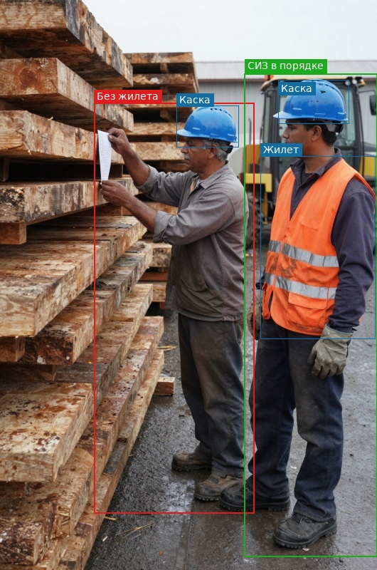

# Детекция СИЗ на стройке

Учебный проект Дмитрия Коновалова и Дмитрия Никишина. YOLOv8n находит людей, каски и сигнальные жилеты. Программа сопоставляет СИЗ с людьми и сохраняет размеченное фото или видео. [План проекта](docs/project-plan.md).



## Установка

Нужны [uv](https://docs.astral.sh/uv/getting-started/installation/) и 64-битный Python. `uv` может установить Python 3.11.

```powershell
uv python install 3.11
uv sync --locked --extra vision
uv run --locked --extra vision pytest
```

GitHub Actions запускает эти тесты на Windows при каждом push и pull request. Для прогона тестов скачивать датасет и веса не требуется.

## Датасет

Используем Ultralytics Construction-PPE с разметкой YOLO. В опубликованном в ноябре 2026 года наборе 1 000 собранных и сгенерированных изображений. Архив занимает около 650 МБ. Источник для атрибуции — Ultralytics, Construction-PPE 2026. [Описание датасета](https://docs.ultralytics.com/datasets/detect/construction-ppe/), [скачать ZIP](https://github.com/ultralytics/assets/releases/download/v0.0.0/construction-ppe.zip), [лицензия CC BY 4.0](https://creativecommons.org/licenses/by/4.0/).

Скачайте архив, распакуйте его в `data/raw` и запустите подготовку данных из корня проекта.

```powershell
uv run --locked --extra vision python -m ppe prepare --config data/raw/construction-ppe/data.yaml --output data/ppe
```

Подготовка оставляет в разметке три класса `person`, `helmet`, `vest`. Исходная обучающая выборка сохраняется. Если в архиве есть тестовая выборка, она используется как есть. Для ноябрьской версии код делит исходную валидационную выборку примерно пополам на `val` и `test`. Разбиение воспроизводится по хешам файлов, а побайтно одинаковые изображения из `val` попадают в одну часть. Для собственных кадров из видео подготовьте разбиение по исходным роликам до запуска конвертации. `prepare` принимает YAML с каталогами изображений для выборок, например `images/train`.

## Обучение и оценка

```powershell
uv run --locked --extra vision python -m ppe train --data data/ppe/data.yaml --epochs 6 --imgsz 320 --batch 8 --device cpu --name baseline
uv run --locked --extra vision python -m ppe evaluate --data data/ppe/data.yaml --weights runs/ppe/baseline/weights/best.pt --imgsz 320 --device cpu
```

Первый запуск обучения загрузит стартовые веса `yolov8n.pt`. После обучения команда напечатает путь к `best.pt`. При повторном запуске используйте напечатанный путь, поскольку Ultralytics нумерует каталоги запусков. Команда оценки сохраняет `metrics.json` с mAP и метриками по классам. Эти показатели измеряют качество детекции, а для оценки статусов работников нужна отдельная разметка принадлежности СИЗ и видимости головы и торса. На машине без CUDA можно передать `--device cpu`. Для быстрой проверки запуска используйте меньше эпох и меньший `--imgsz`.

## Проверка фото и видео

```powershell
uv run --locked --extra vision python -m ppe predict --weights runs/ppe/baseline/weights/best.pt --source docs/examples/site.jpg --output runs/site.jpg --imgsz 320 --device cpu
uv run --locked --extra vision python -m ppe predict --weights runs/ppe/baseline/weights/best.pt --source site.mp4 --output runs/site.mp4 --imgsz 320 --device cpu
```

При первом запуске программа загрузит `yolov8n-pose.pt` для оценки видимости головы и торса. Результат видео записывается в MP4 без звука. На кадре появляются подписи «СИЗ в порядке», «Без каски», «Без жилета» и «Без каски и жилета». Если проверить предмет не удалось, подпись сообщает об этом. Для каждого человека программа рассчитывает два независимых статуса:

- `present` — предмет найден в зоне головы или торса и сопоставлен с человеком.
- `missing` — ключевые точки нужной области видны, а подходящей детекции предмета нет.
- `unknown` — принадлежность предмета неоднозначна, ключевых точек недостаточно или нужная зона сильно перекрыта рамкой другого человека.

Сопоставление использует геометрию рамок и оценку позы. Пропуск детекции каски или жилета может вызвать ложное нарушение, а тесно стоящие люди и перекрытия снижают точность. Статусы относятся к одному кадру.

## Результаты контрольного запуска

YOLOv8n обучен на 800 изображениях в течение 6 эпох на CPU с `--imgsz 320 --batch 8 --name baseline`. На 100 отложенных изображениях получено **mAP50 0,755** и **mAP50–95 0,543**. Из трёх классов хуже всего детектировались каски — AP50 0,616. Прошли все 24 теста, включая проверку сопоставления СИЗ, конвертации разметки и обработки файлов.

Команды выше воспроизводят контрольный запуск. Веса после обучения и результаты обработки сохраняются в локальной папке `runs/`. [Метрики по классам](docs/examples/metrics.json).

## Лицензия

Код проекта подготовлен к публикации на условиях GNU AGPL v3.0. [Текст лицензии](LICENSE), [лицензия Ultralytics YOLO](https://www.ultralytics.com/license).

Исходное фото для примера — `ultralytics-ppe-nov2026-299.jpg` из Ultralytics Construction-PPE, Ultralytics team, ноябрь 2026. Для публикации фото уменьшено, а на размеченную версию нанесены рамки и подписи модели. [Источник](https://docs.ultralytics.com/datasets/detect/construction-ppe/), [CC BY 4.0](https://creativecommons.org/licenses/by/4.0/).
